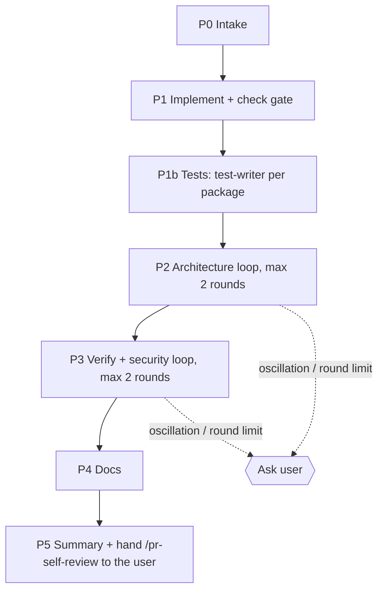

# /run-plan — implement an approved plan with review fix loops

You (the main session) orchestrate. Subagents can't spawn subagents or ask the user, so every agent call, gate and question happens here. Pass **paths, never pasted content** between agents. Brief every agent in English.

Out of scope here: `spec-creator` and `implementation-planner` (the user runs them by hand), commits, pushes and PRs. `test-writer` runs in P1b unless `--no-tests` (then tests are **deferred**, not dropped).



## Arguments

- First path ending in `.md` under `docs/plans/` → **plan** (required).
- `--design <x>` (repeatable) → **designs**. Local image/HTML paths pass through. A claude.ai artifact URL: read it with the Artifact tool (`action: read`) and save the result in the scratchpad; pass that local path.
- `--from <phase>` → resume at `implement | tests | arch | verify | docs | self-review` using the ledger.
- `--review-bugs` → also run `/code-review` in P3 (off by default to save tokens).
- `--no-tests` → skip P1b (test-writer); every `T#` row is recorded as deferred and plan-verifier gets `Tests deferred`.
- `--no-security` → skip the P3 security pass even when the diff qualifies.
- `--no-docs` → skip P4.
- Remaining quoted text → **extra requirements**.

## Ledger

One file per plan: `.claude/sdd-runs/<plan-name>.md` (gitignored). Create it in P0 and update it after every phase and every round; it is how `--from` resumes. Format:

```markdown
# /run-plan run: docs/plans/<name>.md
Spec: <path | —> · Branch: <branch> · Base: <git merge-base main HEAD> · Started: <date>
Designs: <paths | none> · Extra requirements: <text | none>
Phase: <P1 | P1b | P2 r1 | P2 r2 | P3 r1 | ... | done> · Tests: <written: T ids | deferred (--no-tests): T ids>

## Findings
| F | Source | Sev | Fingerprint | State | Round | Note |
|---|---|---|---|---|---|---|
| F1 | arch | WARNING | arch:server/route-thin:server/src/modules/x/routes.ts | fixed | P2 r1 | — |

## Waivers
- F3 — <reason> (user, <date>)

## Backlog
- F5 — <one line>
```

**Fingerprint** = `<source>:<rule id | plan row id | check name>:<file>` — no line numbers (they move between rounds). Sources: `gate`, `tests`, `arch`, `verifier`, `security`, `code-review`, `self-review`. A `tests` fingerprint uses the AC/RQ id: `tests:SPEC-01 AC-3:<test file>`.
**States**: `open → fixed | waived | needs-human | backlog`.

## P0 — Intake

1. Parse the arguments. No plan path → stop: "Pass an approved plan: `/run-plan docs/plans/<name>.md`. Run `implementation-planner` first."
2. Refuse on `main` (`git branch --show-current`) → ask the user to create a branch.
3. Read the plan header:
   - `Status: draft` → AskUserQuestion "Plan is draft — approve and continue?" (Approve / Stop). On Approve, edit the header to `Status: approved`.
   - `Status: done` → stop.
   - `Spec:` present → `git grep -c "NEEDS CLARIFICATION" -- <spec>` must be 0 and the spec `Status` must be `approved`/`implemented`; otherwise stop and tell the user to finish the spec with `spec-creator`.
4. Extra requirements: if any contradicts the plan (a different behaviour, file or contract), AskUserQuestion: "Proceed as a recorded deviation" / "Stop and re-plan manually".
5. Record the plan's `T#` / `TW-*` ids in the ledger `Tests:` field (as deferred only with `--no-tests`).
6. One status line to the user: plan, spec, mode (single/multi), agents (implementer, test-writer, architecture-reviewer, plan-verifier, doc-writer — all Sonnet), and "check the usage dashboard before long runs". Do not wait for an answer unless the user asked for confirmation.

## P1 — Implement + check gate

1. Run the implementer per the plan's `## Execution` table:
   - single-agent: `Agent(subagent_type: "implementer", prompt: "<plan path>" + designs + extra requirements)`;
   - multi-agent: `implementer <plan> workstream W0` alone, then the other `W*` rows **at most 2 in parallel**. Skip every `TW-*` row.
   Prompt suffix for each call: `Designs (UI reference, read them): <paths>`, `Extra requirements (binding; record any deviation): <text>`. Omit empty lines.
2. A workstream `BLOCKED` / `PARTIAL` → show its blockers, AskUserQuestion: retry with an answer / stop.
3. **Check gate**: for each touched package, `scripts/check.sh <pkg>`; add `scripts/check.sh server --it --no-typecheck` when the implementer report has a `Dev DB` line or touched `server/src/db/`. Failing lines → ledger as `gate` findings → `implementer fix: <plan>` with them → re-run only the failing packages. Max 2 attempts, then ask the user.
4. Keep from the reports: `Deviations`, `Failing existing tests`, `Dev DB`. A `Dev DB` line → tell the user to apply the migration (server `INSIGHTS.md` procedure) before opening the UI.
5. Record the last passing (or accepted) summary line of every check-gate command in the ledger under `Check gate:` (e.g. `client: typecheck ok · unit ok — 119 passed`), plus `Touched since gate: none`. Every later fix round appends the packages it touched to `Touched since gate`. P3 hands both to `plan-verifier` so it re-runs only what changed.

## P1b — Tests (skip with `--no-tests`)

`test-writer` writes every test from the plan's `## Tests` table and the spec ACs; the implementer wrote none.

1. Work units: one per `TW-<pkg>` row in the plan's `## Execution`. A plan without `TW-*` rows but with a `Spec:` whose ACs have `verify: unit | integration` → one unit per touched package. Neither → skip P1b and note `Tests: none planned` in the ledger.
2. Dispatch `Agent(subagent_type: "test-writer", prompt: "<plan path> package <pkg>. Failing existing tests (pointers only, verify against the spec): <implementer's Failing existing tests for this package | none>.")`, **at most 2 in parallel**. Never pass the implementer's report, deviations or diff: test-writer derives expectations from the spec on its own.
3. Read each Test report:
   - `Suspected production defects` → one `tests` finding per item (the failing test stays in the tree as the repro). They are fixed in the P3 loop with the verifier gaps, not earlier, so the arch loop and the fix see the same repro.
   - `written, not run — docker unavailable` items → tell the user once; they are not counted as covered.
   - `BLOCKED`, or `PARTIAL` for a reason other than suspected defects → show it, AskUserQuestion: retry with an answer / continue without these tests (record them as deferred) / stop.
   - `Proposed INSIGHTS entries` → keep for the final message.
4. Update the ledger: `Check gate:` lines of each test-writer package are replaced by the test-writer's own `scripts/check.sh` summary lines (now including the new tests; defect repros listed as expected failures), and `Touched since gate` stays `none`.

## P2 — Architecture loop (max 2 fix rounds)

**Review.** `Agent(subagent_type: "architecture-reviewer", prompt: "Diff base: <Base>. Plan (intent only): <plan path>. Implementer deviations: <list | none>.")`
- `PASS` / `NO_DIFF` → P3.
- `FINDINGS` → add each CRITICAL/WARNING/SUGGESTION row to the ledger (`arch`), then **triage** (below).

**Fix round r (1..2).**
1. Snapshot: `ROUND_BASE=$(git stash create)`; empty → `ROUND_BASE=HEAD`. Store it in the ledger.
2. `implementer fix: <plan path>` + the numbered `open` findings to fix (`F<n> — arch — <rule id> — <from:line> — <fix direction>`).
3. Mark results from the fix report: `fixed` (provisionally), `needs-human`, or `not fixed — test is wrong` (→ `test-writer` in the same round with that finding as an extra item, citing the AC/RQ; with `--no-tests` → `backlog`).
4. `scripts/check.sh <pkg> --related <fix files>` per package. Failures → `gate` findings for the next round, except a failing test that is the repro of an open `tests` finding (already tracked).
5. **Recheck**: `architecture-reviewer` with `recheck:` + `Full base: <Base>` + `Round base: <ROUND_BASE>` + `Fix files: <list>` + previous `arch` findings (`F<n> — rule id — from file — quote`) + waivers.
   - `fixed` → state `fixed`; `still present` → stays `open`; new findings → new `F` rows.
6. **Exit** when no `arch` CRITICAL/WARNING is `open` → P3.
7. **Oscillation**: a new finding whose fingerprint matches a row already `fixed` → stop the loop now and ask.
8. After round 2 with anything still `open`, or on oscillation, AskUserQuestion with the open rows:
   - "One more round" (allowed once per loop),
   - "Waive the rest" (ask for a one-line reason → `Waivers`),
   - "Stop the run" (ledger keeps the state; resume with `--from arch`).

## P3 — Verify + security loop (max 2 fix rounds)

**Security pass trigger.** Run it unless `--no-security`, when `git diff --name-only <Base>` (plus untracked files) touches any of:
- `server/src/modules/**/routes.ts`, `server/src/modules/**/service.ts` or `server/src/adapters/**` (new endpoints, request input, outbound calls);
- any file that imports `node:fs`, `node:child_process` or `node:net` / `fetch`, or that builds a path, shell command or SQL from input;
- auth, secrets, tokens or workspace scoping (`_shared/context.ts`, `platform/config.ts`, `repos/**`);
- client code that renders repo, PR or LLM content (Markdown, `dangerouslySetInnerHTML`, links);
- `reviewer-core/src/prompt.ts` (untrusted wrapping), `mcp/src/**`, `.claude/hooks/*.sh`, `scripts/*.sh`.
Otherwise skip it and write `Security: skipped (no qualifying files)` in the ledger.

**Verify.** Dispatch in one message (parallel), as applicable:
- `Agent(subagent_type: "plan-verifier", prompt: "<plan path>. <Tests deferred: --no-tests | omit this sentence>. Extra requirements: <text | none>. Check gate (main session, reuse for unchanged packages): <ledger Check gate lines>. Re-run: <ledger Touched since gate | none>. Known pre-existing failures: <ledger Backlog items marked pre-existing | none>.")`
- Security pass (when triggered): `Agent(subagent_type: "general-purpose", description: "security pass", prompt: "Read-only security review of <the qualifying files> (diff base <Base>, untracked files included). Load the \`security\` skill via the Skill tool. Spec untrusted inputs: <spec ## Untrusted inputs, or the plan's Security handoff line>. For every endpoint or function that takes a path, URL, query or body from a caller, check it is an allowlist (not just traversal-safe) and that it cannot reach secrets (\`.git/\`, \`.env\`, tokens). Verify each finding in code. Return only: \`file:line | CRITICAL|HIGH|MEDIUM | summary | attack scenario\`, or \`No findings\`. CRITICAL = attacker-controlled input reaching injection, secret leak, auth bypass or broken access control at high confidence.")`
- `Skill("code-review")` on the working tree (only with `--review-bugs`).

Ledger: plan-verifier `partial` / `not met` rows → `verifier` findings (fingerprint uses the row id, e.g. `verifier:S3.A:<file>`). `not verifiable` rows → shown to the user, never auto-fixed. Security rows → `security` findings (fingerprint `security:<short slug>:<file>`). code-review findings → `code-review`. An `AC` row with a `no <level> test` remark → a `tests` gap finding (fingerprint `tests:<AC id>:missing`). Open `tests` findings from P1b join this list.

**Fix round r (1..2).** Same as P2 steps 1–4 for production findings (`tests` suspected defects go to `implementer fix:`, which re-runs the failing repro test). Then, unless `--no-tests`, one `test-writer <plan path> package <pkg>` per package with open `tests` gap findings or `test is wrong` rows, passing them as extra items. Then re-run **only** the sources that had open findings: `plan-verifier` every round (with `Re-run:` = packages the fix touched), the security pass only if it had open CRITICAL/HIGH rows (scoped to the fix files plus the files of those rows), `/code-review` only if it had findings, and `architecture-reviewer recheck:` (fix files only) whenever the fix touched production code. Same exit, oscillation and round-limit rules as P2.

`VERIFIED` (deferred T rows allowed only with `--no-tests`), no `tests` finding open, no security CRITICAL/HIGH `open`, and nothing else `open` → P4.

## Triage (P2 and P3, before each fix round)

| Finding | Action |
|---|---|
| CRITICAL, WARNING, `gate` failure, `tests` suspected defect or missing test, verifier `not met` / `partial`, `security` CRITICAL / HIGH | fix automatically |
| SUGGESTION, nits, `security` MEDIUM | one AskUserQuestion call per round with one **single-select** question per finding (fix now / backlog / waive; at most 4 per call, batch the rest) — never one multiSelect over mixed options |
| fix report `needs-human`, or a finding that contradicts the plan or spec | AskUserQuestion: waive (reason) / stop and re-plan manually |
| verifier `not verifiable` | show; the user decides (usually a manual check) |

Waived fingerprints are passed to every later recheck so they aren't raised again.

## P4 — Docs

Unless `--no-docs`: `Agent(subagent_type: "doc-writer", prompt: "<plan path>")`. Collect its "proposed human edits".

## P5 — Summary and self-review handoff

`pr-self-review` is `disable-model-invocation: true`: never call `Skill("pr-self-review")` (it fails) and never replicate its workflow by other means. The user starts it.

1. Set the ledger `Phase: awaiting /pr-self-review`. Send the final message below and stop.
2. When the user then runs `/pr-self-review` in this session and it returns `BLOCKED`: add its CRITICAL rows as `self-review` findings, run one fix round (same fix steps as P2), set `Phase: awaiting /pr-self-review (after fix)`, and ask the user to run it again. Still `BLOCKED` after that → stop and report. On `✅ Ready for PR` set `Phase: done`.

Final message (short):

```
/run-plan <plan path> — <DONE (pending /pr-self-review) | STOPPED at P#>
Spec: <path | —> · Files changed: <n> (`git diff --stat <Base>` totals)
Checks: <per package: ok/FAIL> · Arch: <PASS after r rounds> · Verifier: <VERIFIED | GAPS n> · Security: <clean | n open | skipped>
Waived: <F ids + reasons | none> · Backlog: <F ids | none> · Needs human: <… | none>
Tests: <n tests added · AC coverage covered/total · not run (docker): ids | deferred (--no-tests): T ids> · Proposed INSIGHTS: <… | none>
Docs: <files | skipped> · Proposed human edits: <… | none>
Suggested commit: <type(scope): summary>
Next: type `/pr-self-review` as the very first characters of your next prompt (no leading space)
Retro: optionally run /workflow-retro [--deep] in this session (manual, writes docs/retro/ledger/)
```

Never commit, push or open a PR. The user does that.

## Stop conditions (always ask, never loop)

- Any loop past its round limit, or an oscillating fingerprint.
- An implementer `BLOCKED`, or a `needs-human` finding.
- The plan or spec changes on disk during the run (`git diff --name-only` shows the plan/spec) → re-read and ask.
