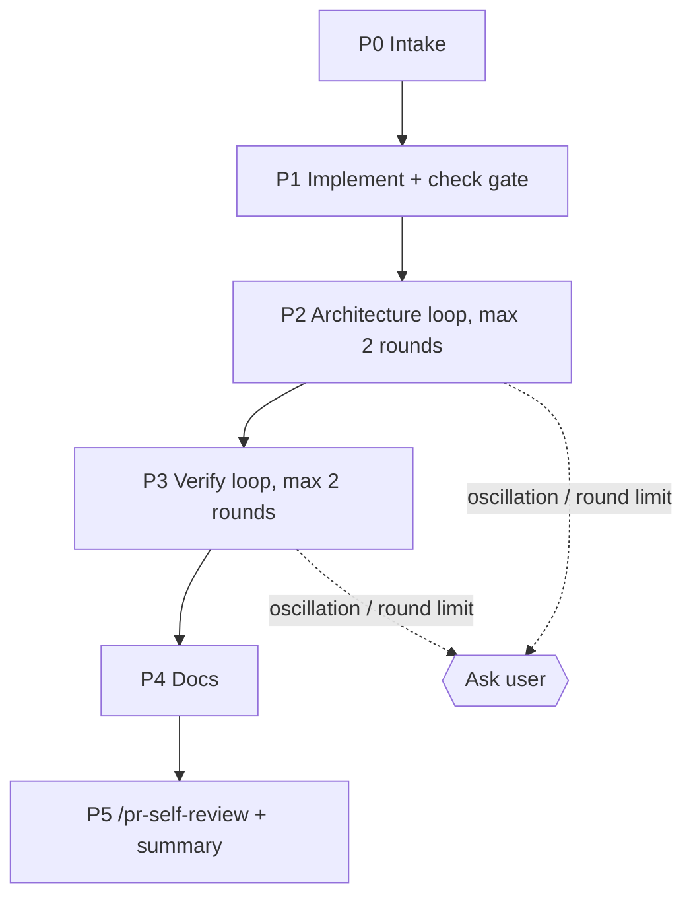

# /run-plan — implement an approved plan with review fix loops

You (the main session) orchestrate. Subagents can't spawn subagents or ask the user, so every agent call, gate and question happens here. Pass **paths, never pasted content** between agents. Brief every agent in English.

Out of scope here: `spec-creator` and `implementation-planner` (the user runs them by hand), `test-writer` (disabled for now to save tokens — tests are **deferred**, not dropped), commits, pushes and PRs.



## Arguments

- First path ending in `.md` under `docs/plans/` → **plan** (required).
- `--design <x>` (repeatable) → **designs**. Local image/HTML paths pass through. A claude.ai artifact URL: read it with the Artifact tool (`action: read`) and save the result in the scratchpad; pass that local path.
- `--from <phase>` → resume at `implement | arch | verify | docs | self-review` using the ledger.
- `--review-bugs` → also run `/code-review` in P3 (off by default to save tokens).
- `--no-docs` → skip P4.
- Remaining quoted text → **extra requirements**.

## Ledger

One file per plan: `.claude/sdd-runs/<plan-name>.md` (gitignored). Create it in P0 and update it after every phase and every round; it is how `--from` resumes. Format:

```markdown
# /run-plan run: docs/plans/<name>.md
Spec: <path | —> · Branch: <branch> · Base: <git merge-base main HEAD> · Started: <date>
Designs: <paths | none> · Extra requirements: <text | none>
Phase: <P1 | P2 r1 | P2 r2 | P3 r1 | ... | done> · Deferred tests: <T ids | none>

## Findings
| F | Source | Sev | Fingerprint | State | Round | Note |
|---|---|---|---|---|---|---|
| F1 | arch | WARNING | arch:server/route-thin:server/src/modules/x/routes.ts | fixed | P2 r1 | — |

## Waivers
- F3 — <reason> (user, <date>)

## Backlog
- F5 — <one line>
```

**Fingerprint** = `<source>:<rule id | plan row id | check name>:<file>` — no line numbers (they move between rounds). Sources: `gate`, `arch`, `verifier`, `code-review`, `self-review`.
**States**: `open → fixed | waived | needs-human | backlog`.

## P0 — Intake

1. Parse the arguments. No plan path → stop: "Pass an approved plan: `/run-plan docs/plans/<name>.md`. Run `implementation-planner` first."
2. Refuse on `main` (`git branch --show-current`) → ask the user to create a branch.
3. Read the plan header:
   - `Status: draft` → AskUserQuestion "Plan is draft — approve and continue?" (Approve / Stop). On Approve, edit the header to `Status: approved`.
   - `Status: done` → stop.
   - `Spec:` present → `git grep -c "NEEDS CLARIFICATION" -- <spec>` must be 0 and the spec `Status` must be `approved`/`implemented`; otherwise stop and tell the user to finish the spec with `spec-creator`.
4. Extra requirements: if any contradicts the plan (a different behaviour, file or contract), AskUserQuestion: "Proceed as a recorded deviation" / "Stop and re-plan manually".
5. Record `Deferred tests:` = every `T#` / `TW-*` id in the plan's `## Tests` and `## Execution`.
6. One status line to the user: plan, spec, mode (single/multi), agents (implementer, architecture-reviewer, plan-verifier, doc-writer — all Sonnet), and "check the usage dashboard before long runs". Do not wait for an answer unless the user asked for confirmation.

## P1 — Implement + check gate

1. Run the implementer per the plan's `## Execution` table:
   - single-agent: `Agent(subagent_type: "implementer", prompt: "<plan path>" + designs + extra requirements)`;
   - multi-agent: `implementer <plan> workstream W0` alone, then the other `W*` rows **at most 2 in parallel**. Skip every `TW-*` row.
   Prompt suffix for each call: `Designs (UI reference, read them): <paths>`, `Extra requirements (binding; record any deviation): <text>`. Omit empty lines.
2. A workstream `BLOCKED` / `PARTIAL` → show its blockers, AskUserQuestion: retry with an answer / stop.
3. **Check gate**: for each touched package, `scripts/check.sh <pkg>`; add `scripts/check.sh server --it --no-typecheck` when the implementer report has a `Dev DB` line or touched `server/src/db/`. Failing lines → ledger as `gate` findings → `implementer fix: <plan>` with them → re-run only the failing packages. Max 2 attempts, then ask the user.
4. Keep from the reports: `Deviations`, `Failing existing tests`, `Dev DB`. A `Dev DB` line → tell the user to apply the migration (server `INSIGHTS.md` procedure) before opening the UI.

## P2 — Architecture loop (max 2 fix rounds)

**Review.** `Agent(subagent_type: "architecture-reviewer", prompt: "Diff base: <Base>. Plan (intent only): <plan path>. Implementer deviations: <list | none>.")`
- `PASS` / `NO_DIFF` → P3.
- `FINDINGS` → add each CRITICAL/WARNING/SUGGESTION row to the ledger (`arch`), then **triage** (below).

**Fix round r (1..2).**
1. Snapshot: `ROUND_BASE=$(git stash create)`; empty → `ROUND_BASE=HEAD`. Store it in the ledger.
2. `implementer fix: <plan path>` + the numbered `open` findings to fix (`F<n> — arch — <rule id> — <from:line> — <fix direction>`).
3. Mark results from the fix report: `fixed` (provisionally), `needs-human`, or `not fixed — test is wrong` (→ `backlog`, since test-writer is off).
4. `scripts/check.sh <pkg> --related <fix files>` per package. Failures → `gate` findings for the next round.
5. **Recheck**: `architecture-reviewer` with `recheck:` + `Full base: <Base>` + `Round base: <ROUND_BASE>` + `Fix files: <list>` + previous `arch` findings (`F<n> — rule id — from file — quote`) + waivers.
   - `fixed` → state `fixed`; `still present` → stays `open`; new findings → new `F` rows.
6. **Exit** when no `arch` CRITICAL/WARNING is `open` → P3.
7. **Oscillation**: a new finding whose fingerprint matches a row already `fixed` → stop the loop now and ask.
8. After round 2 with anything still `open`, or on oscillation, AskUserQuestion with the open rows:
   - "One more round" (allowed once per loop),
   - "Waive the rest" (ask for a one-line reason → `Waivers`),
   - "Stop the run" (ledger keeps the state; resume with `--from arch`).

## P3 — Verify loop (max 2 fix rounds)

**Verify.** In parallel when `--review-bugs`, otherwise alone:
- `Agent(subagent_type: "plan-verifier", prompt: "<plan path>. Tests deferred: test-writer disabled. Extra requirements: <text | none>.")`
- `Skill("code-review")` on the working tree (only with `--review-bugs`).

Ledger: plan-verifier `partial` / `not met` rows → `verifier` findings (fingerprint uses the row id, e.g. `verifier:S3.A:<file>`). `not verifiable` rows → shown to the user, never auto-fixed. code-review findings → `code-review`.

**Fix round r (1..2).** Same as P2 steps 1–4, then re-run **only** the sources that had open findings: `plan-verifier` every round, `/code-review` only if it had findings, and `architecture-reviewer recheck:` (fix files only) whenever the fix touched production code. Same exit, oscillation and round-limit rules as P2.

`VERIFIED` (deferred T rows allowed) and nothing `open` → P4.

## Triage (P2 and P3, before each fix round)

| Finding | Action |
|---|---|
| CRITICAL, WARNING, `gate` failure, verifier `not met` / `partial` | fix automatically |
| SUGGESTION, nits | one AskUserQuestion (multiSelect) per round: fix now / backlog / waive |
| fix report `needs-human`, or a finding that contradicts the plan or spec | AskUserQuestion: waive (reason) / stop and re-plan manually |
| verifier `not verifiable` | show; the user decides (usually a manual check) |

Waived fingerprints are passed to every later recheck so they aren't raised again.

## P4 — Docs

Unless `--no-docs`: `Agent(subagent_type: "doc-writer", prompt: "<plan path>")`. Collect its "proposed human edits".

## P5 — Self-review and summary

1. `Skill("pr-self-review")`. `BLOCKED` → one fix round (`self-review` findings, same fix steps) → re-run once. Still `BLOCKED` → stop and report.
2. Set the ledger `Phase: done`. Final message (short):

```
/run-plan <plan path> — <DONE | STOPPED at P#>
Spec: <path | —> · Files changed: <n> (`git diff --stat <Base>` totals)
Checks: <per package: ok/FAIL> · Arch: <PASS after r rounds> · Verifier: <VERIFIED | GAPS n>
Waived: <F ids + reasons | none> · Backlog: <F ids | none> · Needs human: <… | none>
Deferred tests: <T ids> → run test-writer manually when re-enabled
Docs: <files | skipped> · Proposed human edits: <… | none>
Suggested commit: <type(scope): summary>
Retro: optionally run /workflow-retro [--deep] in this session (manual, writes docs/retro/ledger/)
```

Never commit, push or open a PR. The user does that.

## Stop conditions (always ask, never loop)

- Any loop past its round limit, or an oscillating fingerprint.
- An implementer `BLOCKED`, or a `needs-human` finding.
- The plan or spec changes on disk during the run (`git diff --name-only` shows the plan/spec) → re-read and ask.
