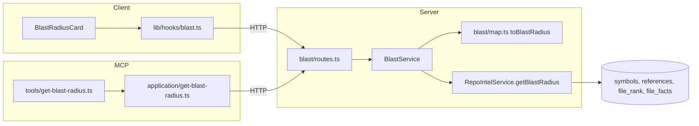
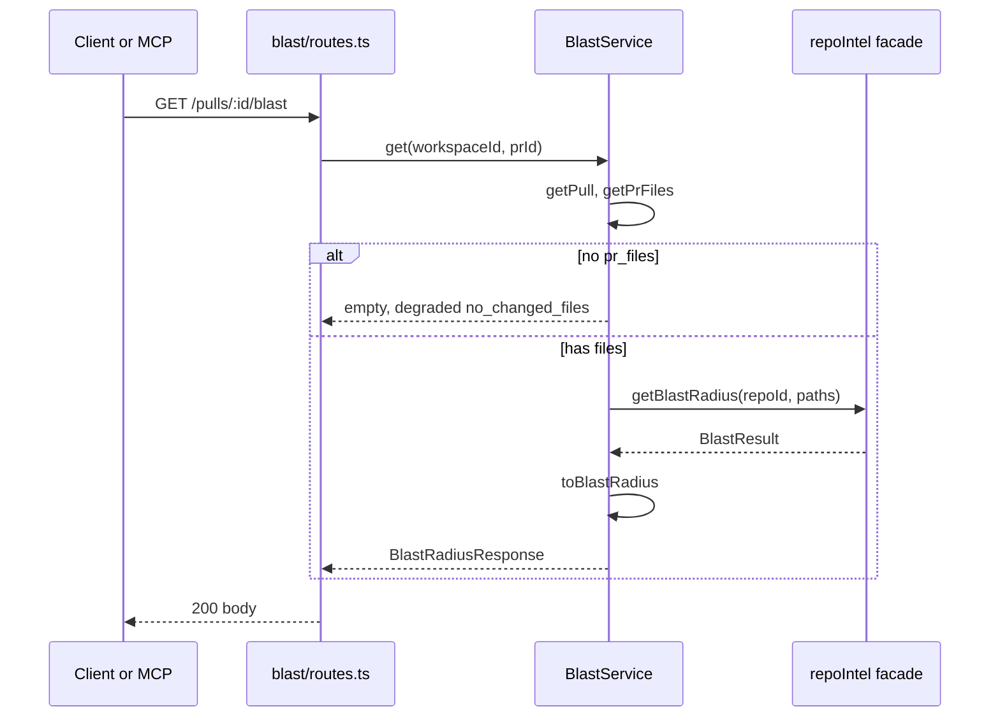

# Blast radius

Type: explanation (how the feature works, for contributors).

Blast radius shows what else in the repository a pull request can affect. For the symbols declared in the PR's changed files, it lists their callers (`file:line`) and the HTTP endpoints and cron jobs that depend on them. It appears as a **Blast radius** card on the PR Overview tab and as the MCP tool `get_blast_radius`. Both read the same `GET /pulls/:id/blast` response. The feature reads the precomputed `repo-intel` index. It makes no LLM call and does no analysis at request time.

## How it works

**Route and service.** `BlastService.get` loads the PR (404 `NotFoundError` if it is missing or in another workspace), reads the PR's persisted `pr_files`, and calls `container.repoIntel.getBlastRadius(repoId, paths)` once. If the PR has no persisted files, the service returns an empty response with `degraded: true, reason: 'no_changed_files'` and does not call the facade.

**Mapping.** The pure function `toBlastRadius` turns the facade's flat `callers[]` (each tagged with `viaSymbol`) into the shared `BlastRadiusResponse`:

- One `downstream` entry per changed symbol name that has at least one caller, in `changed_symbols` order. Symbols with no callers are left out of `downstream` but stay in `changed_symbols`.
- Callers keep the facade order (rank descending) and map to `{ name, file, line }`.
- A group's endpoints and crons are the de-duplicated union of `factsByFile[callerFile]` over that group's caller files. Without `factsByFile` (the ripgrep fallback) they are empty.
- `summary` is `"<n> symbols · <n> callers · <n> endpoints · <n> crons"`. Endpoint and cron counts are unique across groups.
- `degraded` and `reason` pass through from the facade (`undefined` becomes `false` and `null`).

**Facade behaviour you rely on.** `tryPersistentBlast` in `repo-intel` caps callers per changed symbol at `MAX_CALLERS_PER_SYMBOL` (20), not for the whole list. A `partial` index returns its data with `degraded: true, reason: 'index_partial'`. The ripgrep fallback is unchanged and reports `no_data`. See the [repo-intel README](../../server/src/modules/repo-intel/README.md).

**Degraded states.** `reason` is one of `flag_off`, `index_failed`, `index_partial`, `repo_too_large`, `no_data`, `no_changed_files`. A degraded response that still has callers shows the data and a notice. It does not hide the data.

**UI.** `BlastRadiusCard` renders, in order: a degraded notice (if any), a stat row (symbols, callers, endpoints, crons, computed from the arrays by `blastStats`), a Tree/Graph toggle, and the content.

- Tree: one collapsible row per `downstream` entry. The first starts expanded. Each caller is a `file:line` link built with `githubBlobUrl(repoFullName, headSha, file, line)`. Endpoint and cron chips follow.
- Graph: an inline SVG for the symbol that is expanded or selected in the tree. `layoutBlastGraph` places three columns: changed symbol, callers, endpoints and crons. Symbol-to-caller edges are solid. Symbol-to-endpoint and symbol-to-cron edges are dashed, because the contract attributes endpoints per symbol, not per caller.
- Empty states: `noSymbols` when `changed_symbols` is empty, `noDownstream` when there are symbols but no `downstream`, and `error` when the request fails.
- Rebuild index: every degraded reason except `no_changed_files` shows a **Rebuild index** button. It calls `useResyncRepoIntel`, then polls `useRepoIntelStatus` until `updatedAt` changes and invalidates the `['pr-blast', prId]` query.

**MCP.** `getBlastRadius` resolves the repo and PR, calls `api.blast(prId)` (`GET /pulls/:id/blast`), and returns structured output plus text. The text starts with `UNTRUSTED_MARKER` (symbol and file names come from repo content), then a head line, a degraded line when applicable, and one block per symbol with `↳ file:line (name)`, `endpoints:` and `crons:` lines. For `no_changed_files` the degraded line asks you to open the PR in the DevDigest UI. The tool is registered with `readOnlyHint: true` and `openWorldHint: false`.

## Diagrams

Components:

Request:

## Key files

- [`server/src/modules/blast/routes.ts`](../../server/src/modules/blast/routes.ts), [`service.ts`](../../server/src/modules/blast/service.ts), [`map.ts`](../../server/src/modules/blast/map.ts)
- [`server/src/modules/repo-intel/service.ts`](../../server/src/modules/repo-intel/service.ts) (`tryPersistentBlast`)
- [`server/src/vendor/shared/contracts/brief.ts`](../../server/src/vendor/shared/contracts/brief.ts) (`BlastDegradedReason`, `BlastRadiusResponse`; the client keeps a byte-identical copy)
- [`client/src/lib/hooks/blast.ts`](../../client/src/lib/hooks/blast.ts)
- [`client/src/app/repos/[repoId]/pulls/[number]/_components/BlastRadius/`](<../../client/src/app/repos/[repoId]/pulls/[number]/_components/BlastRadius/>)
- [`mcp/src/application/get-blast-radius.ts`](../../mcp/src/application/get-blast-radius.ts), [`mcp/src/tools/get-blast-radius.ts`](../../mcp/src/tools/get-blast-radius.ts)

## Limitations

- Callers are precise, not exhaustive: only references whose declaration resolved to a changed file count, so ambiguous names can be missed.
- At most 20 callers are returned per changed symbol.
- Endpoints and crons are attributed per symbol, not per caller, so the graph draws them as dashed symbol-level edges.
- The result is only as fresh as the index. Use **Rebuild index** after large changes.
- Without a persistent index the ripgrep fallback has no endpoint or cron data and always reports `no_data`.
- The contract exists twice (`server` and `client`) and you must edit both by hand.

## Related docs

- [Plan: add-blast-radius](../plans/add-blast-radius.md)
- [repo-intel README](../../server/src/modules/repo-intel/README.md)
- [mcp README](../../mcp/README.md)
