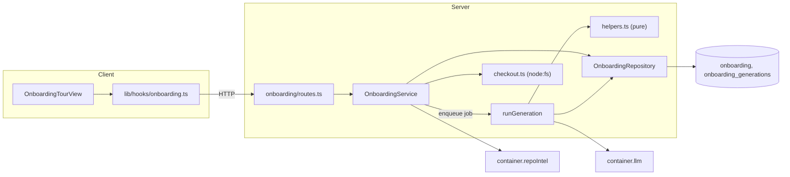
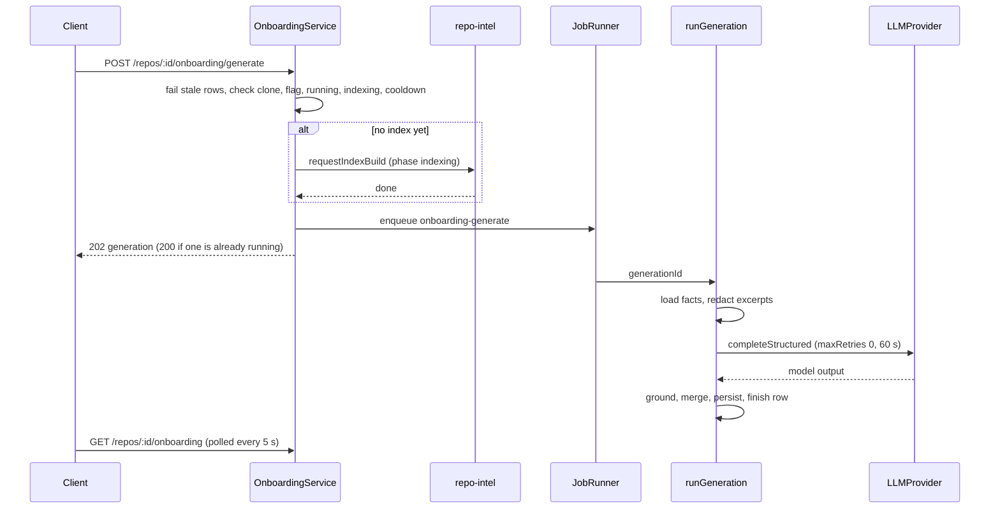

# Onboarding Tour

Diátaxis type: explanation (contributor audience), with a short operations note at the end.

The Onboarding Tour is a per-repo page at `/repos/:repoId/onboarding-tour`. It shows five fixed sections: Architecture, Critical paths, Run locally, Reading path and First tasks. Most of the content comes from the repo-intel index and the repo's checkout, with no model call. One structured LLM call writes only the prose: the architecture summary and diagram, a reason per ranked file, and up to three first tasks. Generation runs as an async job, with one running generation per repo and a 60 s cooldown. When the index, the checkout or the model output is unusable, the page shows a facts-only skeleton with a reason instead of hiding the failure.

Spec: [SPEC-02](../../specs/onboarding/SPEC-02-onboarding-tour.md). Plan: [add-onboarding-tour](../plans/add-onboarding-tour.md).

## How it works

Reading the page never calls a model. `GET /repos/:id/onboarding` returns the persisted tour, or a deterministic skeleton when none exists. The model is called only after `POST /repos/:id/onboarding/generate`.

### Generation flow

1. **Start.** `startGeneration` runs these checks in order. Each failing check maps to an error: not cloned (422), repo intel off (409 `repo_intel_disabled`), a generation already running (returns it with 200), indexing in progress (409 `indexing_in_progress`), and cooldown (429 `onboarding_cooldown` with `retryAfterSeconds`). It then inserts a `running` row in `onboarding_generations`. A partial unique index allows one `running` row per repo, and a lost race returns the winner's row.
2. **No index yet.** The row starts in phase `indexing`, `requestIndexBuild` enqueues the repo-intel index job, and the generate job is enqueued when that job's `done` resolves. If the build fails, the row is finished as `index_failed`.
3. **Facts.** `loadTourFacts` combines index state, `getTourFacts` (ranks, importers, endpoints, critical-path chains, indexed paths) and `readRunFacts` (package scripts, `.env.example` names, compose file, README, top-level directories).
4. **Model call.** `runGeneration` makes one `completeStructured` call with `maxRetries: 0`, wrapped in `withTimeout` (60 s). The adapter's own transport retries still apply. It never throws, because JobRunner retries throwing handlers.
5. **Grounding.** `groundModelOutput` keeps only what the index and checkout back up (see below). `mergeGenerated` lays the grounded prose over the skeleton. The result is re-validated with `OnboardingTour.safeParse` and saved to the `onboarding` table.
6. **Failure.** A failed generation leaves the previous tour untouched and records a `reason` on the generation row: `ai_output_invalid` (schema miss or merged result invalid), `ai_unavailable` (other errors or timeout), `index_failed`, `no_data`, `flag_off`, `no_supported_files` or `interrupted`.

### What is deterministic and what is model text

| Content | Source |
|---|---|
| Stack, top-level directories, run commands, env var names | Checkout files and `deriveCommands` / `detectStack` in `helpers.ts` |
| Critical paths and reading path (max 25 each) | Index ranks, ordered by `pagerank * (1 + hotness)` |
| Importer and endpoint counts, complexity | Index edges and symbols |
| Architecture summary and diagram, reasons for the top 8 entries per list, up to 3 first tasks | The single model call |

Grounding rules in `groundModelOutput`:
- A reason is dropped when its path is not an indexed path, when it mentions a path or backticked file that is neither indexed nor allowlisted, or when it matches a count claim such as "14 routes". The numbers shown come from index facts instead.
- Model run commands are kept only if they match a command derived from the checkout. The persisted commands always come from `deriveCommands`.
- A first task needs an indexed file or a known directory.
- Persisted run commands, ranks and counts never come from the model.

### Skeleton and states

`buildSkeleton` produces the facts-only tour (`mode: 'skeleton'`, `generatedAt: null`, no first tasks, all reasons null). The client's `pickView` maps the server state to one of five views: `not_cloned`, `indexing`, `empty` (the "Generate onboarding tour" call to action), `skeleton` and `generated`. While a first generation runs, the sections show placeholders. During a regeneration, the previous tour stays and Regenerate is `aria-disabled`. The page polls every 5 s while the index is being built or a generation is running. A tour is `stale` when its `indexedSha` differs from the repo's current `lastIndexedSha`, and the page then offers Regenerate and Re-analyze.

"Indexing" is derived by `repoIntel.isIndexing`, a time-bounded read of the `jobs` table: queued or running index, refresh or resync jobs inside `INDEX_JOB_WINDOW_MS` (420 s). Older rows count as orphaned. Generation rows still `running` after `GENERATION_STALE_MS` are failed lazily as `interrupted` on each state read or start, and rows started before the app booted are failed at boot.

## Security hardening

The excerpts sent to the model come from the user's repo, so they are treated as untrusted data and secrets are removed before the call.

- **Redaction before the call.** In `generation.ts`, the README and file excerpts go through `redactText`, `package.json` through `redactPackageJson` (name, scripts and dependency names only) and the compose file through `redactCompose` (environment values replaced, names kept). `isSecretKey` decides whether a `KEY=value` or `key: value` line holds a secret. Well-known token shapes (private key blocks, `sk-`, `ghp_` and similar, `AKIA`, `xox*`) are replaced with `<redacted>`. Each replaced value is collected, filtered by `isTrackableSecret` (at least 4 characters, not digits only, not a trivial literal such as `true`).
- **Echoed secrets are dropped.** `groundModelOutput` receives the collected secrets and discards the summary, diagram, reasons and task titles for which `containsSecret` is true.
- **No links or images from the model.** `stripMarkdownLinks` removes images, unwraps links and removes bare URLs from the summary on the server. On the client, `ArchitectureBody` renders the summary with `skipHtml`, `disallowedElements={["img", "a"]}` and `unwrapDisallowed`, which are optional props added to the vendored `Markdown` primitive.
- **Untrusted delimiters.** `buildModelMessages` wraps the index facts and every excerpt with `wrapUntrusted`, and each excerpt is capped at 4,000 characters.
- **Log allowlist.** `runGeneration` logs only generation id, repo id, status, reason, duration, tokens and model. It never logs excerpts or model text.

## Key files

Server (`server/src/modules/onboarding/`):
- [`routes.ts`](../../server/src/modules/onboarding/routes.ts): the two endpoints; registers the job handler at boot.
- [`service.ts`](../../server/src/modules/onboarding/service.ts): `getState`, `startGeneration`, stale handling.
- [`generation.ts`](../../server/src/modules/onboarding/generation.ts): `runGeneration`.
- [`helpers.ts`](../../server/src/modules/onboarding/helpers.ts): ranking, commands, redaction, grounding, `buildSkeleton`, `mergeGenerated`.
- [`checkout.ts`](../../server/src/modules/onboarding/checkout.ts), [`facts.ts`](../../server/src/modules/onboarding/facts.ts), [`prompt-input.ts`](../../server/src/modules/onboarding/prompt-input.ts), [`model-output.ts`](../../server/src/modules/onboarding/model-output.ts), [`repository.ts`](../../server/src/modules/onboarding/repository.ts), [`constants.ts`](../../server/src/modules/onboarding/constants.ts).
- [`checkout-fs.ts`](../../server/src/modules/_shared/checkout-fs.ts): `resolveInside` and `isDirectory`, moved out of `context/checkout.ts`.
- `getTourFacts`, `isIndexing` and `requestIndexBuild` on the `RepoIntel` facade: [`repo-intel/service.ts`](../../server/src/modules/repo-intel/service.ts).
- Prompt: [`onboarding.system.md`](../../server/src/prompts/onboarding.system.md). Tables: `onboarding_generations` in [`schema/context.ts`](../../server/src/db/schema/context.ts), migration [`0020_chief_silver_sable.sql`](../../server/src/db/migrations/0020_chief_silver_sable.sql).
- Contracts (identical in `server/src/vendor/shared/contracts/knowledge.ts` and `client/src/vendor/shared/contracts/knowledge.ts`): `OnboardingTour`, `OnboardingTourState`, `OnboardingGeneration`, `GenerateOnboardingResponse`.

Client:
- [`onboarding-tour/page.tsx`](../../client/src/app/repos/[repoId]/onboarding-tour/page.tsx) and the view in [`_components/OnboardingTourView/`](../../client/src/app/repos/[repoId]/onboarding-tour/_components/OnboardingTourView/OnboardingTourView.tsx); `pickView` and `shouldPoll` are in its `helpers.ts`.
- [`lib/hooks/onboarding.ts`](../../client/src/lib/hooks/onboarding.ts): `useOnboardingTour`, `useGenerateOnboardingTour`. Re-analyze reuses `useResyncRepoIntel`.
- Sidebar entry in [`vendor/ui/nav.ts`](../../client/src/vendor/ui/nav.ts) and `activeKeyFor` in [`app-shell/helpers.ts`](../../client/src/components/app-shell/helpers.ts) (now matches `/onboarding-tour`, so the add-repo page `/onboarding` no longer lights the tab).
- Copy: `client/messages/en/onboarding.json`.

## Limitations

- **Apply migration 0020 by hand to the shared dev database.** Do not rely on `db:migrate` there. The procedure and the drift risks are in [`server/INSIGHTS.md`](../../server/INSIGHTS.md) (Recurring Errors & Fixes, 2026-10-02). The SQL is written with `IF NOT EXISTS` and guarded constraints so it can be applied repeatedly.
- **Re-analyze has no workspace check.** It reuses the existing `POST /repos/:id/resync`, which does not verify the workspace. This is known and out of scope here.
- Only JS/TS files are indexed (`.ts`, `.tsx`, `.js`, `.jsx`, `.mjs`, `.cjs`); other repos get the "No supported source files" state.
- The outer 60 s timeout does not cancel the in-flight HTTP request to the provider. Transport retries by the adapter (429, 5xx, network errors) can send the request more than once.
- The tour does not compute git hotness. It reads the `hotness` value stored in `file_rank` (`getRankRows`) and ranks by `fileRank(pagerank, hotness)`.
- No cancel, no hand-editing, no export, no "Share link".

## Related docs

- [SPEC-02](../../specs/onboarding/SPEC-02-onboarding-tour.md) and the [plan](../plans/add-onboarding-tour.md)
- [repo-intel README](../../server/src/modules/repo-intel/README.md)
