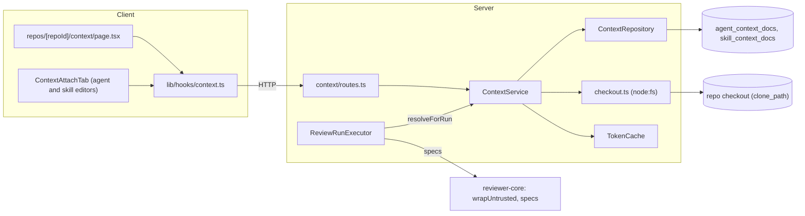
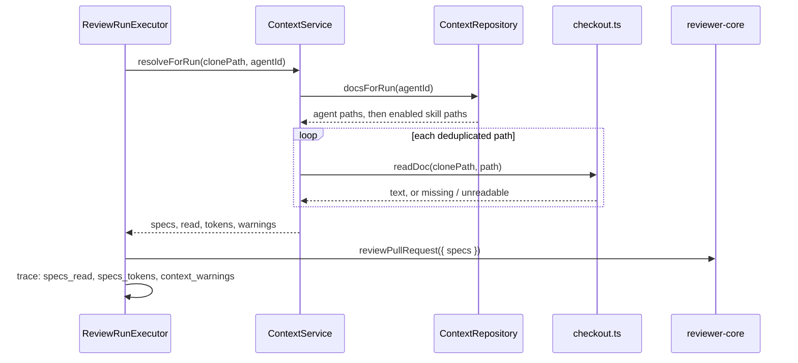

# Project context

Type: explanation (how the feature works, for contributors).

Project context lets you browse the Markdown files in a repository's local checkout, attach them to agents and skills in a chosen order, and have them injected into agent runs as an untrusted `## Project context` prompt block. The run trace shows which files were read, how many tokens they cost, and any warnings. The feature is read-only: you cannot create, edit, upload or delete documents. It reads only the local checkout at `repos.clone_path`, never GitHub.

## How it works

**Browse.** `GET /repos/:id/context` scans the checkout for `.md` files whose repo-relative path matches the configured search globs (`CONTEXT_SEARCH_GLOBS`, default `**/{specs,docs,insights}/**/*.md`, so `server/docs/x.md` is listed and a root `README.md` is not). The scan skips `node_modules`, `vendor` and `.git` at any depth and never follows symlinks. Results are sorted by path and capped at 500 files; a `truncated` flag tells the UI to show a notice. The response also carries `search_roots`, the folder names the globs search, which the empty state names. Each item carries:

- `category`: the nearest folder (deepest first) named `specs`, `docs` or `insights` in the path; `other` only for custom-glob matches outside those folders.
- `tokens`: counted by `container.tokenizer`. It is `null` when the file is not previewable (over 256 KB, not valid UTF-8, or containing a NUL).
- `used_by_agents`: the number of distinct agents that use the path, directly or through an enabled skill.

If the repo has no checkout, the response is `{ cloned: false, docs: [] }`. `GET /repos/:id/context/file?path=` returns one document's text. A path that escapes the checkout is rejected with a validation error and no content. `resolveInside` refuses absolute paths, `..` segments, NUL bytes and any symlink anywhere on the path, including a symlink that stays inside the checkout (for example `docs/guide.md` pointing at `.git/config`): the real path must equal the lexical one. The same check applies when a run reads an attached document.

**Configure.** Set `CONTEXT_SEARCH_GLOBS` in `server/.env` to a comma-separated list of repo-relative posix globs (commas inside `{}` are kept). An empty value, an absolute glob, a `..` segment, a NUL byte or unbalanced braces falls back to the default. The result is `AppConfig.contextSearchGlobs`. See [`server/README.md`](../../server/README.md#environment).

**Attach.** `GET|PUT /agents/:id/context` and `GET|PUT /skills/:id/context` store an ordered list of repo-relative paths. A `PUT` replaces the whole list in one transaction, so toggle, reorder and detach all send the full list. Attachments store only the path, so the Context tab lists the documents of the active repo. A path missing from that checkout is shown as "File missing" with a Detach action. Saving does not check that the file exists on disk.

**Inject.** At run start, `ReviewRunExecutor` calls `container.contextDocs.resolveForRun(repo.clonePath, agent.id)`:

1. Paths come from the agent's own documents, then each skill that is enabled on both the agent link and the skill itself, in skill order. A duplicate path is kept once, at its first position.
2. Each path is read from the checkout. A missing, oversized or unreadable file is skipped with a warning, and the run continues.
3. Each document becomes the chunk `### <path>\n\n<text>`. reviewer-core wraps each chunk in its own untrusted block, so the path label sits inside the block, also for a truncated document. The total is capped at 8,000 tokens. The chunk that crosses the cap is cut by binary search (up to 12 iterations) and later documents are dropped. A final `Notice: project context exceeded 8,000 tokens. Truncated: … Dropped: …` string is appended to the block and to the warnings.
4. If the checkout is unavailable, the run continues without the block and records the warning `Project context skipped: repository checkout unavailable`.
5. With no attached documents, no `specs` are passed, so the prompt has no Project context block.

The resolved strings go to reviewer-core as `ReviewInput.specs`. reviewer-core stays pure and does no file access. `wrapUntrusted` now neutralizes any `<untrusted…>` or `</untrusted…>` variant (case, whitespace, attributes) by rewriting its leading `<` to `<\`, so document text cannot close the delimiter. It also escapes `"`, `<` and `>` in the label.

**Trace.** The run trace gets `prompt_assembly.specs_tokens` and `context_warnings`, both nullish so old traces still parse. `specs_read` lists the injected paths. `specs_read_detail` (nullish, `{ path, tokens }[]`) gives the tokens of each injected chunk as injected, including the `### path` label and any truncation; the executor sets it to `null` when nothing was injected. The Configuration "Specs read" rows show "≈ n tokens" next to each path when the detail is present. The UI shows warnings as plain text. Assembling the block makes no LLM call: `resolveForRun` only reads files and counts tokens.

## Diagrams

Components:

Run-time injection:

## UI

- **Navigation.** "Project Context" (folder icon) is in the WORKSPACE group directly below "Pull Requests" ([`nav.ts`](../../client/src/vendor/ui/nav.ts)).
- **Page.** A file list on the left and a preview pane on the right. The preview header shows the category badge, tokens and modified time; the preview is Markdown only (no edit).
- **Context tab (agent and skill editors).** One header row with the title, an "{n} attached" pill and the "Filter documents…" input; the note sits on the line below. The skill tab titles the section "Project context to use" and shows a "Serializes as" code block starting with `## Project context`, followed by the attached paths.

## Data model

Two tables, each with a cascading foreign key to its owner, primary key `(owner_id, path)` and an integer `order`: `agent_context_docs` and `skill_context_docs` (migration `0019_careless_titania.sql`). Attachments are not part of `agentVersions.configJson` and do not bump agent or skill `version`.

## Logging

The route logs `context.scan` with repo id, file count, truncation and duration. The executor logs `context.injected` with run id, document count, tokens and skipped paths. Neither logs document content.

## Key files

- Server module: [`server/src/modules/context/`](../../server/src/modules/context/) (`routes.ts`, `service.ts`, `repository.ts`, `checkout.ts`, `token-cache.ts`, `constants.ts`, `helpers.ts`)
- Run wiring: [`server/src/modules/reviews/run-executor.ts`](../../server/src/modules/reviews/run-executor.ts)
- Schema: [`server/src/db/schema/context-docs.ts`](../../server/src/db/schema/context-docs.ts)
- Prompt hardening: [`reviewer-core/src/prompt.ts`](../../reviewer-core/src/prompt.ts)
- Page: [`client/src/app/repos/[repoId]/context/`](../../client/src/app/repos/[repoId]/context/)
- Shared UI: [`client/src/components/context-docs/`](../../client/src/components/context-docs/)
- Data hooks: [`client/src/lib/hooks/context.ts`](../../client/src/lib/hooks/context.ts)
- Trace: [`TraceBody.tsx`](../../client/src/app/repos/[repoId]/pulls/[number]/_components/RunTraceDrawer/_components/TraceBody/TraceBody.tsx)

## Limitations

- Read-only. Only `.md` files, whole documents (no chunking or retrieval), no secret scanning.
- Only the local checkout is read. With several repos in a workspace, a path attached while viewing repo A can be "File missing" in repo B.
- Scans re-read the disk on every request. Token counts are cached in-process by absolute path, mtime and size (up to 5,000 entries), so only changed files are re-tokenized.
- A cold scan of many large files can be slow; measure with the `context.scan` log.
- Skill-inherited documents are not included in the agent tab's token total.

## Related docs

- Plan: [`add-project-context.md`](../plans/add-project-context.md)
- Spec: [`SPEC-01-project-context.md`](../../specs/project-context/SPEC-01-project-context.md)
- Server API map: [`server/README.md`](../../server/README.md)
